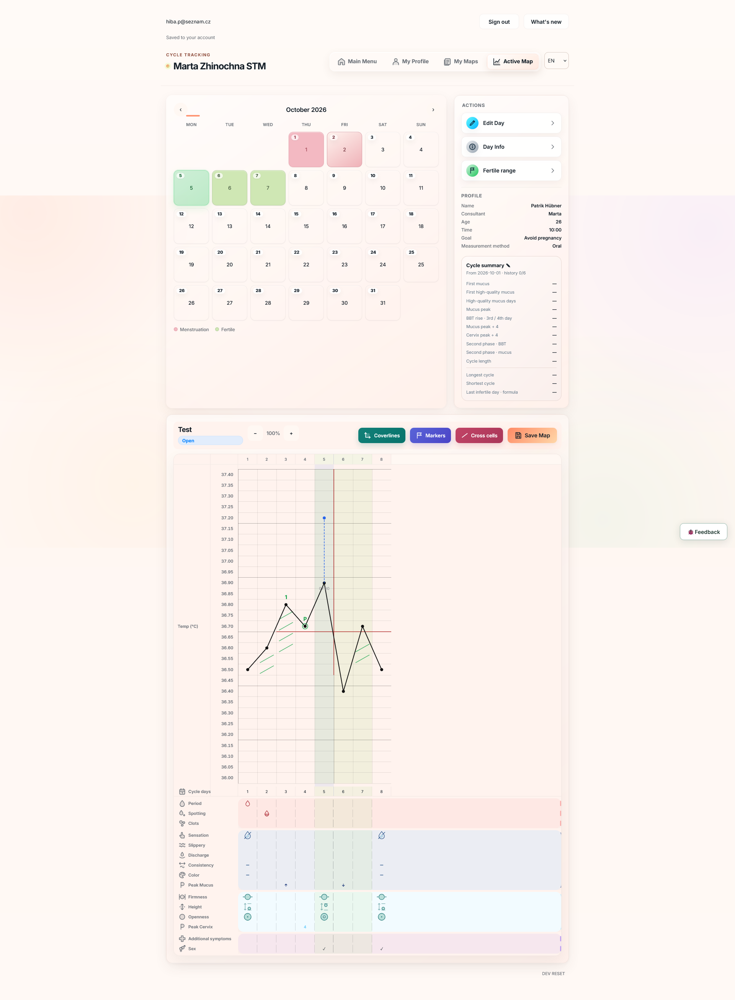
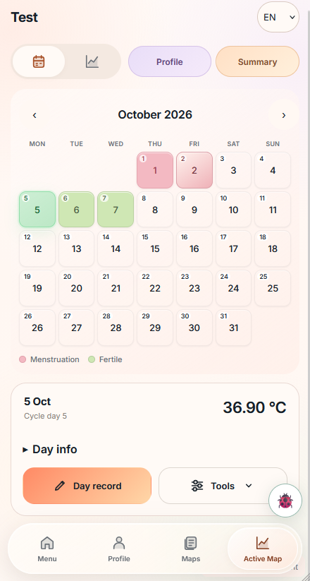
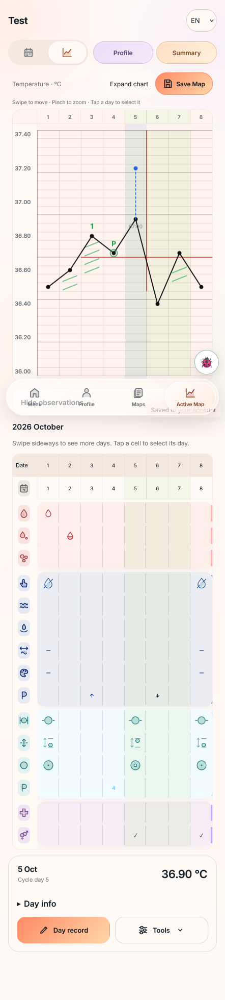
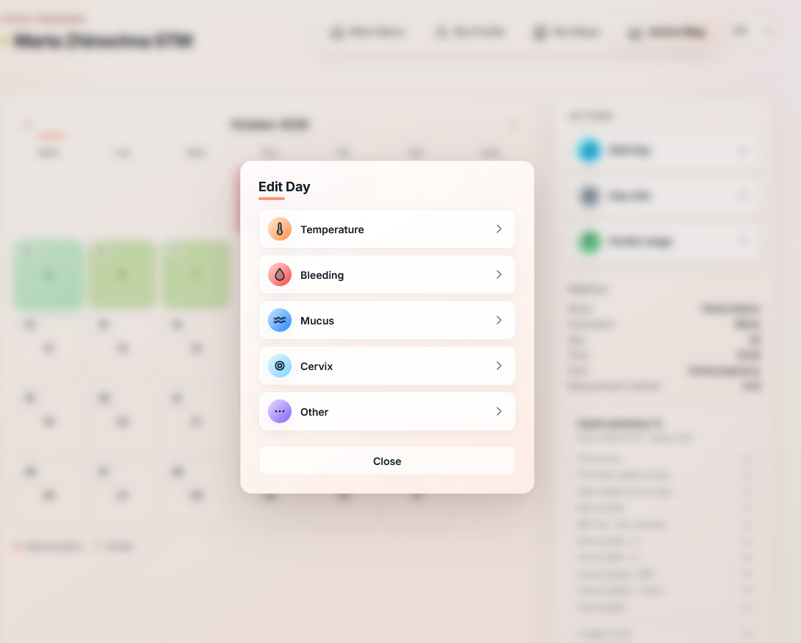
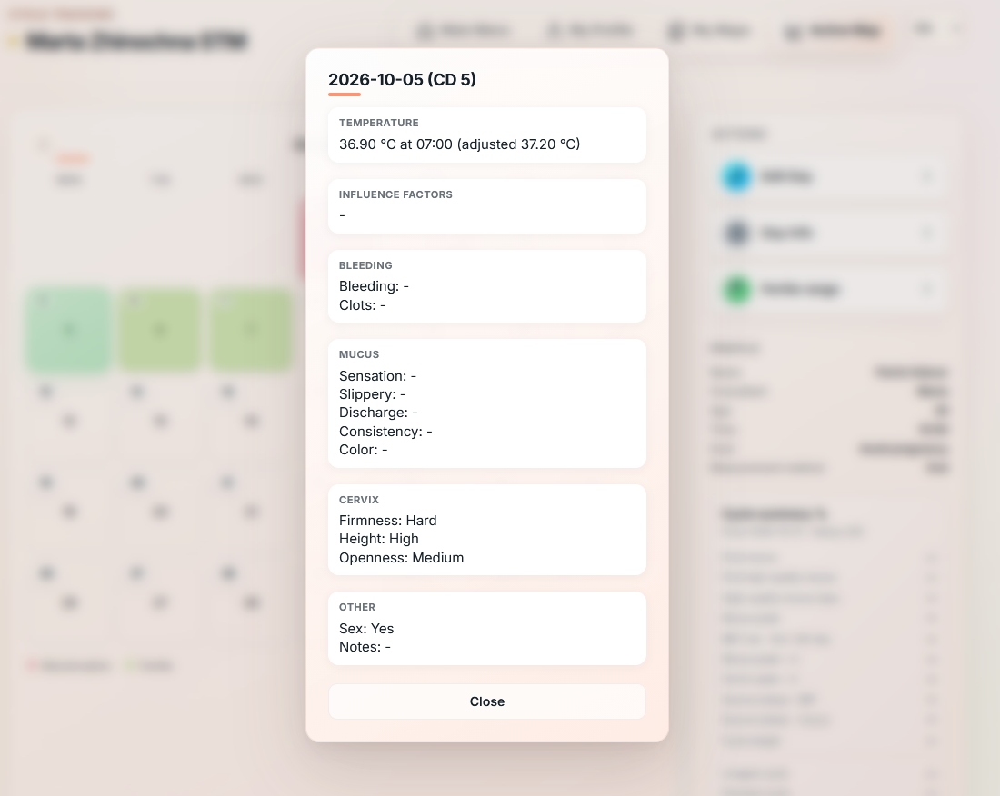
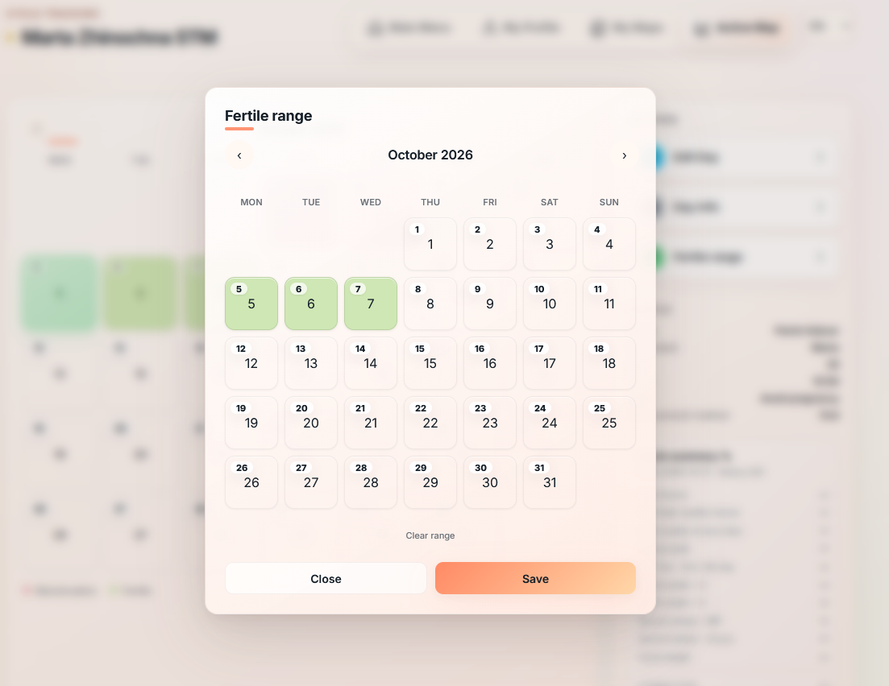
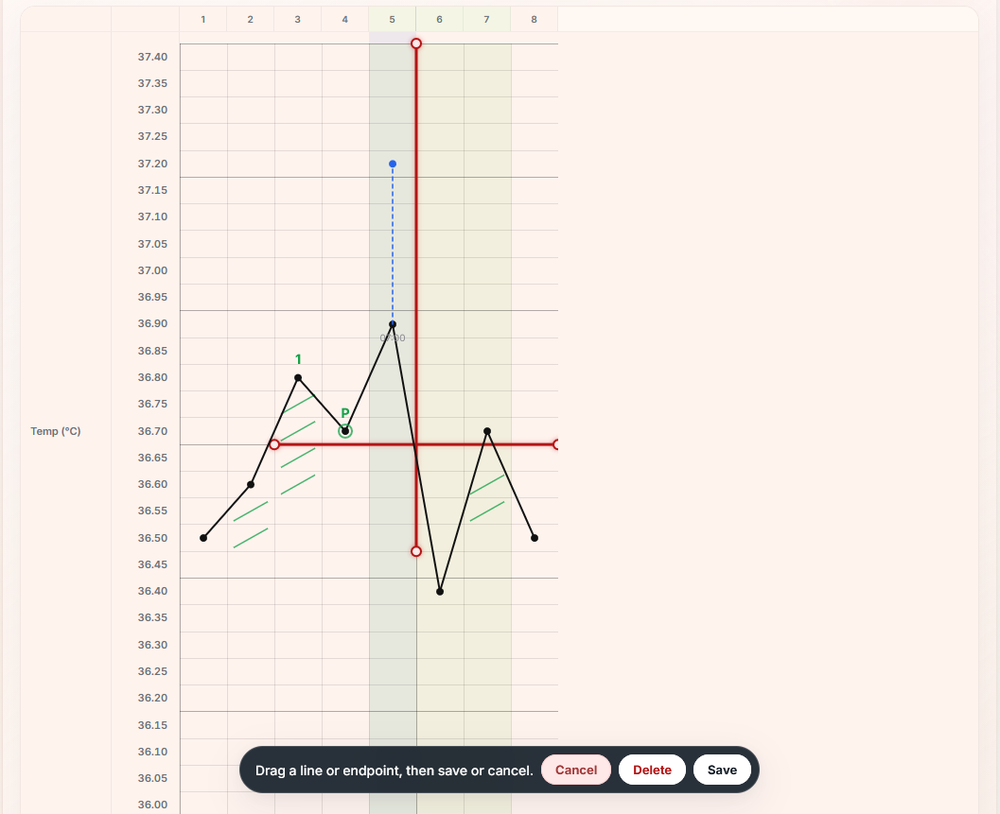
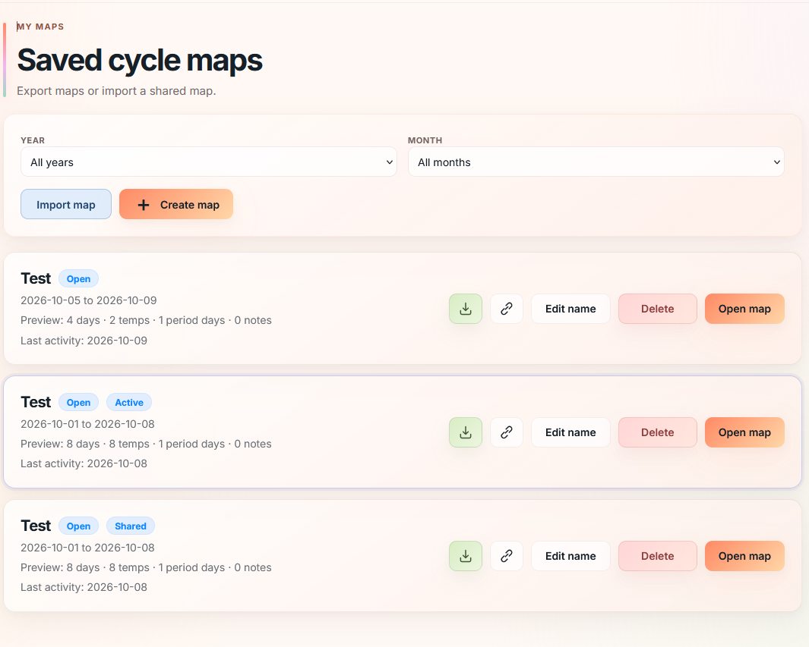

<div align="center">

# Cycle Tracker

A browser app for recording daily observations and reviewing them on a symptothermal cycle chart. You decide how to interpret what you record.

[Live Demo](https://cycle-6mf61zw3o-hubnerpatriks-projects.vercel.app/) · [Changelog](CHANGELOG.md) · [Contributing](CONTRIBUTING.md)

**Active prototype · v0.16.0**

</div>

## Active map

The active map brings the calendar, temperature chart, cycle summary and daily observations together. The chart plots basal body temperature on a fixed 0.05 °C grid. A time-adjusted temperature can appear alongside the original measurement.



## On your phone

The active map opens in Calendar. Switching to Graph keeps the selected day and zoom. Pinch to zoom, swipe to move across the chart or use **Show all** in **Tools** to reset the view. Below the chart, you can reveal the observation rows, expand the selected day's details or open **Day record**.

<table>
  <tr>
    <td valign="top" align="center"></td>
    <td valign="top" align="center"></td>
  </tr>
  <tr>
    <td align="center"><sub>Calendar</sub></td>
    <td align="center"><sub>Graph and observations</sub></td>
  </tr>
</table>

## Record and review a day

Choose a date and open **Edit Day** to record temperature, measurement time, influence factors, bleeding, mucus, cervix observations, sex or other symptoms. **Day Info** brings the saved observations together in a read-only summary.

<table>
  <tr>
    <td width="50%" valign="top"></td>
    <td width="50%" valign="top"></td>
  </tr>
  <tr>
    <td align="center"><sub>Choose what to record</sub></td>
    <td align="center"><sub>Review the saved day</sub></td>
  </tr>
</table>

The browser's Back and Forward buttons work across the main screens and day editors. Reloading an editor restores its map, date and saved values. Leaving or reloading the editor discards unsaved changes.

## Mark up the chart

Use **Fertile range** to select individual days on the calendar. They can be nonconsecutive, and the app highlights them in the calendar and on the chart.



Place coverlines, peak markers, arrows and cross-cell marks directly on the chart. To adjust a coverline, select it, drag the line or an endpoint, then save.



## Manage and share maps

**My Maps** lists saved maps and lets you filter them by year or month. Create, rename, close or reopen a map as needed. One map is active at a time. After sign-in, the app opens that map if one exists. Otherwise it opens **My Maps** after profile setup.



- **Share** creates a read-only copy of a map's observations. Anyone with the link can view it for seven days. This feature requires the `003-shared-maps.sql` migration.
- **Download** exports a PDF observation card. Excel and JSON appear as disabled options in v0.16.0.
- **Import map** accepts original PDF, Excel (.xlsx) and JSON exports from Cycle Tracker. It checks the embedded data and asks for confirmation before adding the map. Existing maps and the recipient's profile are preserved. Imported maps retain the author's saved profile snapshot.

## Accounts and storage

[Neon Auth setup](docs/auth-setup.md) covers email/password registration, email verification and password reset. **My Profile** stores measurement preferences and supports an optional JPG, PNG or WebP photo up to 10 MB.

Profiles, maps and manual annotations sync to Neon Postgres through the authenticated `/api/state` endpoint. Each account has a separate browser cache and a queue for changes awaiting upload. If two devices make conflicting edits, the app offers a local backup before switching to the cloud version. See [cloud storage and recovery](docs/cloud-storage.md).

The **Feedback** button opens a thread attached to a UI element. The designated support administrator can review reports across accounts and see numbered pins. See [feedback setup and export details](docs/feedback.md).

## Local development

The frontend uses vanilla JavaScript, HTML Canvas, CSS and Vite. The Vercel API handles authenticated access to Neon Postgres.

Requires Node.js 20.19+ and npm. Copy `.env.example` to `.env` and configure `DATABASE_URL` and `VITE_NEON_AUTH_URL` before migrating the database.

```bash
npm ci
npm run db:migrate
npx vercel dev
```

For localhost UI development, set `VITE_DEV_AUTH_BYPASS=true` in `.env.development.local` and run `npm run dev`. This mode uses isolated browser storage. Cloud sync, sharing and feedback require the server setup.

Run `npm run check` for lint, tests and the production build. See [CONTRIBUTING.md](CONTRIBUTING.md) for the branch and release workflow.

## Disclaimer

Cycle Tracker is an educational tool for recording and visualizing observations. It does not provide medical advice, contraception guidance or an automated fertility assessment.
